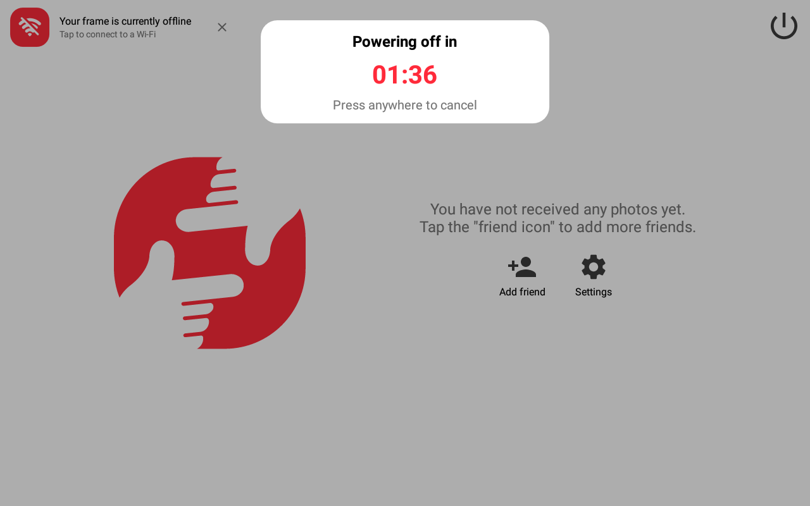

# BIUFRAME 10.1" frame: browser setup guide

Turns a BIUFRAME 10.1-inch picture frame into a touchscreen browser device. It adds Firefox,
a normal launcher, WebView 106, a larger swap, and a navigation bar, and it switches off the vendor apps.

Tested on one unit (2026-09-30). The research log behind every step is [biuframe.md](biuframe.md).
Automation: [`scripts/biuframe-setup.sh`](../scripts/biuframe-setup.sh).

**Check the SoC, not just the brand.** A BIUFRAME-branded PF1007L was also found
with an Allwinner A33 / AiMOR board. This RK3126 guide and its `apply` script do
not apply to it; use the [Allwinner PF1007L guide](allwinner-a33-pf1007l.md).
A `10X1` with manufacturer `incar` and a `user.fyl.20170927` build has the same SoC but a
different partition layout, so `check`, `backup` and `apply` stop on it; see
[yiaisign-10x1.md](yiaisign-10x1.md).

**For agents:** follow the steps in order. Stop at the first failed check and report it; do not
improvise around a mismatch. Every command runs from the repository root on a Mac with the frame
connected over USB.

## Read this first

This frame cannot be made secure. Know these limits before you use it:

- **Any app can get root without a prompt.** The firmware ships SuperSU's `su` and a
  `daemonsu` service but no SuperSU manager app, so nothing asks for approval. Install nothing you
  do not trust.
- **The last security patch is from July 2016** (Linux 3.10, SELinux permissive).
- **The vendor apps contact servers in China** (Adups FOTA, the Biu Frame cloud). This guide disables them.
- **Do not sign into a primary Google, Apple, or bank account on it.** Use a separate
  account, a read-only calendar link (Google Calendar's "Secret address in iCal format"), or a
  dashboard you host yourself. Use Firefox rather than WebView-based apps for logins; its engine is newer.
- Keep the frame on a guest or IoT Wi-Fi network.

## What you need

- A Mac with Homebrew, `adb` (`brew install android-platform-tools`), `curl`, `openssl`, `unzip`,
  and about 3 GB free.
- A USB-C **data** cable plugged **directly** into the Mac. Some cables only carry power, and a dock
  or hub may not work. With a working cable the frame shows up within a second or two.
- The frame on Wi-Fi (Firefox and the certificate downloads need internet on the Mac, not the frame).

## Step 1: Connect and authorize ADB

1. Power the frame and connect USB-C to the Mac.
2. Run `adb devices -l`.
   - `unauthorized`: tap **Allow** on the frame's "Allow USB debugging?" prompt, tick
     **Always allow**, and run it again.
   - Nothing listed: try another cable or port. Check `system_profiler SPUSBHostDataType | grep -A3 0x2207`.
     VID `0x2207` is Rockchip.
3. Expected: one device with `model:10X1 device:rk312x`.

ADB is enabled in the stock firmware; no developer settings are needed.

## Step 2: Confirm it is the same hardware

```sh
scripts/biuframe-setup.sh check
```

This changes nothing. Every line must be `ok`:

| Check | Expected |
| --- | --- |
| Build fingerprint | `rockchip/rk312x/rk312x:6.0.1/MXC89K/user.thzy.20240919.143320:user/release-keys` |
| Model | `Synergy 10X1` |
| CPU | `Rockchip RK3126` |
| Wi-Fi driver | `ssv6x5x` loaded |
| Root | `su -c id` returns `uid=0(root)` |
| Layout | `boot` (`mmcblk0p5`) starts at eMMC sector 90112 |

**Any mismatch: stop.** Frames sold under the same name can have different boards or firmware.
The WebView and partition steps depend on these exact values.

## Step 3: Back up the firmware

```sh
scripts/biuframe-setup.sh backup
```

- Reads eMMC sectors 0–3,891,199 (the first 1.86 GiB, everything before `userdata`) over ADB with
  root into `backups/<serial>/emmc-0-3891200.img.gz`. It takes a few minutes.
- Checks that the length is exactly 1,992,294,400 bytes and that the gzip reads back to the same SHA-256,
  then re-reads `boot`, `recovery`, and 16 MiB of `system` file data and compares them with the backup.
  To re-check later: `scripts/biuframe-setup.sh verify-backup backups/<serial>/emmc-0-3891200.img.gz`.
- Tested: 7 min 15 s over USB, 1,992,294,400 bytes, about 522 MB compressed.
- The ext4 superblock and journal at the start of `system` change while the frame runs (SuperSU remounts
  `/system` several times a minute), so a byte-for-byte comparison of the whole image with a later read will differ
  there. That is expected.
- It includes the Rockchip boot loader area in the first 4 MiB.
- It does not include `userdata` (photos, Wi-Fi settings). This guide does not touch `userdata`.

Keep the backup. Restoring it needs Rockchip loader mode and `rkdeveloptool` (see
[biuframe.md](biuframe.md)); nothing in this guide writes partitions.

## Step 4: Apply the setup

```sh
scripts/biuframe-setup.sh apply
```

Each step checks its own result and stops the script if the check fails. It is safe to run again. At the end the frame
reboots once and the script verifies the result. The whole run takes about 2 minutes plus downloads.

| # | Step | What changes | Check |
| --- | --- | --- | --- |
| 1 | Vendor apps off | `pm disable` for Biu Frame, Adups FOTA, Rockchip update service, StressTest, DeviceTest, RkExplorer, MediaFloat; `pm hide` for Adups FOTA and StressTest | Each package `enabled=2`/`3`; hidden ones `hidden=true` |
| 2 | Swap 128 → 512 MB | Adds `/system/su.d/50zram` and one line at the end of `/system/bin/install-recovery.sh` | `/proc/swaps` shows `524280` |
| 3 | Apps | Installs Firefox 143.0.4 (armeabi-v7a) and Rootless Pixel Launcher 3.9.1 | Both in `pm list packages` |
| 4 | WebView 44 → 106 | Replaces `/system/app/webview/webview.apk`, deletes its `oat/`, adds `lib/arm/*.so` | File MD5s match; after reboot `versionName=106.0.5249.126` and no `Failed to load library` |
| 5 | Let's Encrypt roots | Adds `6187b673.0` (ISRG Root X1) and `8794b4e3.0` (ISRG Root X2) to `/system/etc/security/cacerts/` | Files present, mode 0644 |
| 6 | Navigation bar | Appends `qemu.hw.mainkeys=0` to `/system/build.prop` | After reboot a `NavigationBar` window exists |

Downloads are pinned and checked before use:

| File | Source | SHA-256 |
| --- | --- | --- |
| Firefox 143.0.4 | `archive.mozilla.org/pub/fenix/releases/143.0.4/` | `af560738627d4efc9ace75e708fc48aad6a24c78ef43a89daca27e16ff3829f8` |
| Rootless Pixel Launcher 3.9.1 | `f-droid.org/repo/amirz.rootless.nexuslauncher_30911.apk` | `7fa44d560dc4577374d45176220de2c0b00a71e09d6d148cdea4e0a52d38404a` |
| WebView 106.0.5249.126 | LineageOS `android_external_chromium-webview_prebuilt_arm` @ `4b0ae494a7dd` | `e2edc1f89ec1608b169da9e7ffc037190b70c7825f0be29694f4cae719980580` |
| ISRG Root X1 / X2 | `letsencrypt.org/certs/` | Checked by certificate fingerprint (in the script) |

Optional: `BIUFRAME_LIGHTNING=1 scripts/biuframe-setup.sh apply` also installs Lightning 5.1.0, a
small browser that uses the system WebView (useful for testing WebView).

### Why the non-obvious parts are needed

- **WebView libraries:** WebView 106 stores its native libraries compressed. Android 6 does not
  extract them for apps in `/system`, so swapping only the APK (as some online guides do) reports
  version 106 but fails to load with `dlopen failed … /system/vendor/lib`.
- **Let's Encrypt roots:** Android 6's trust store predates them. Without them, WebView apps
  reject most self-hosted HTTPS sites. Firefox has its own store and is unaffected.
- **`pm hide`:** Adups FOTA and StressTest are persistent system apps that Android 6 still starts
  when they are only disabled.
- **`install-recovery.sh` hook:** SuperSU's `/system/su.d` folder is not run at boot on this
  firmware. `install-recovery.sh` runs as root on every boot, after swap is set up.
- **Remount before `chmod`:** something remounts `/system` about 12 times a minute (the ext4 mount
  count rose 15,036 → 15,042 in 30 s; SuperSU's `daemonsu` is the likely cause, and was confirmed as the cause on a
  [Uhale 102KZ](uhale-102kz.md#daemonsu-is-what-remounts-system)), so it can turn read-only between two
  commands. Each step remounts it read-write right before changing permissions, then checks the permissions afterwards.

## Step 5: Finish on the frame

1. Press **Home** (or run `adb shell input keyevent KEYCODE_HOME`), pick **Rootless Pixel
   Launcher**, tap **Always**. Biu Frame is disabled, so it may pick the launcher automatically.
2. Open Firefox from the dock. Optional: Settings → Customize → Theme → **Dark** (see below).
3. Drag any other icons you want from the app drawer (swipe up) to the home screen.

## Known limits

- **No Home or Recents button.** This firmware's SystemUI hard-codes them invisible; the navigation
  bar shows only volume down, Back, and volume up. Tap Back until you reach the launcher.
- **The navigation bar is hard to see in Firefox with the light theme.** Firefox makes the bar transparent and the
  icons are white. Use Firefox's dark theme.
- **1 GB RAM.** Heavy sites are slow; with the larger swap they should no longer freeze the frame.
- **Motion sensor:** the PIR sensor is `gpio-107` (`ir_gpio`). With Biu Frame disabled, nothing
  uses it to wake the screen yet.
- Firefox 143 and WebView 106 are the last versions for Android 6 and receive no more updates.

## Undo

| Change | Undo (run with `adb shell su -c '…'`) |
| --- | --- |
| Vendor apps | `pm unhide com.adups.fota; pm unhide com.cghs.stresstest`, then `pm enable <pkg>` for each |
| WebView | `mount -o remount,rw /system; cp /system/app/webview/webview.apk.bak /system/app/webview/webview.apk; rm -rf /system/app/webview/lib /system/app/webview/oat`, reboot |
| Swap | `mount -o remount,rw /system; cp /system/bin/install-recovery.sh.bak /system/bin/install-recovery.sh; rm -r /system/su.d`, reboot |
| CA roots | `mount -o remount,rw /system; rm /system/etc/security/cacerts/6187b673.0 /system/etc/security/cacerts/8794b4e3.0` |
| Navigation bar | `mount -o remount,rw /system; cp /system/build.prop.bak /system/build.prop`, reboot |
| Apps | `adb uninstall org.mozilla.firefox`, `adb uninstall amirz.rootless.nexuslauncher` |

## Akimart ZN-DP1002 (RK3126)

Frames sold under the Akimart brand can have completely different logic boards. This script supports the RK3126 version, selected by an **exact** `ro.build.fingerprint` match (`rk312x … user.cdm`; the script refuses anything else, including other RK3126 fingerprints). If your frame is the RK3326 version (logical `rknand0` storage, Android 8.1, fingerprint contains `rk3326_go`), do not use this script.

Units matching the RK3126 `AKIMART` profile share this same setup pipeline with these differences:
- **Model property:** `ZN-DP1002`, manufacturer `rockchip`.
- **Vendor Apps:** Preloaded with Frameo (`net.frameo.frame`), Muxintu OTA (`com.muxintu.app.mxota`), and Device Test (`com.szclink.app.cldevicetest`). All are disabled and hidden.
- **Wi-Fi Driver:** Uses `rk915` instead of `ssv6x5x`.
- **Partition Bounds:** `boot` is at 90112, `recovery` at 122880, `system` at 630784, and `userdata` at 2859008 (backup covers 2,859,008 sectors).

**Results:** On the tested unit, the script successfully backed up 1.36 GiB of eMMC, debloated Frameo, expanded swap to 512 MB, injected WebView 106, and enabled the navigation bar and Let's Encrypt certificates.

**One-unit observations:**
- **system verify:** On the tested unit, reading the `system` partition starting at sector 630784 failed the post-write verification because the ext4 superblock/journal changed while mounted. The `verify-backup` step skips 16 MiB (32768 sectors) past the start of the partition to avoid this dynamic area.
- **Cable note:** On one unit, the supplied cable was power-only, and a USB-C to USB-C cable from a computer's USB-C port provided no power or data. A USB-A to USB-C data cable was required.

**Undo instructions specific to the Akimart profile:**
- **Vendor Apps:** `pm unhide com.muxintu.app.mxota; pm unhide com.szclink.app.cldevicetest`, then `pm enable <pkg>` for them and `net.frameo.frame`, `android.rockchip.update.service`
- **Swap / ZRAM:** `mount -o remount,rw /system; cp /system/bin/install-recovery.sh.bak /system/bin/install-recovery.sh; rm -f /system/su.d/50zram; mount -o remount,ro /system`, reboot

### SSA ZN-DP1002: sensor, clock and diagnostic limits

Read-only checks on a separate Linux-connected frame reporting firmware
`SSA-ZN-DP1002-V1.0.1202509261611.release-keys`, RK3126, Android 6.0.1 and Frameo
1.27.5, sold as Runxion 10.1-inch (Amazon `B0FSZ86HTM`, owner-confirmed).
This is the build reported in
[#134](https://github.com/wesbos/photo-frame-dashboard/pull/134), **not** the supported
`user.cdm` Akimart profile above. #134 covers a different physical unit's setup, backup
and network-traffic tests; none was repeated here. This report does not qualify the
setup script for this firmware; keep its fingerprint guard unchanged.

| Check | Observation | What it establishes |
| --- | --- | --- |
| Accelerometer | `gs_mir3da` bound at I²C `0-0026`; `gsensor` input; changing XYZ events in `sensorservice` | A working acceleration input. Named gyro, compass, light, pressure, proximity and temperature sensors had no readings in this capture; their presence remains unverified. |
| Bluetooth | Android declares Bluetooth; manager off, no controller in `/sys/class/bluetooth`, no BLE feature declaration | Neither working Bluetooth/BLE nor its physical absence is established. |
| RTC | `rtc0` names `hym8563`; kernel reports `hctosys: invalid date/time`; RTC reads `2065-25-45` and `45:85:85` | An RTC driver exists but did not supply valid time. This does not prove a missing battery, identify a fault or establish retention after a power cut. |
| Clock and build | Running clock in May 2021; kernel/firmware build in September 2025; Android patch level July 2016 | These are different dates. An About-screen date is unreliable with this clock; a newer build date does not establish newer security patches. |
| CPU / GPU | Four ARMv7 cores; CPU table `816000 1008000` kHz; Mali-400 MP table only `297000000` Hz | Configured frequencies, not a speed comparison or an overclocking route. |
| Display | Android reports `1280×800`, 160 dpi, `56.648` Hz | Reported mode, not measured panel refresh, frame rate or input latency. |
| Battery / thermals | BatteryService says `present: false`, level 100 and temperature 424; no thermal zones exposed | Do not treat the level as a battery test or the temperature as a CPU measurement. |
| Storage | `mmcblk0/size` is `60620800`; `/proc/partitions` gives `30310400` blocks | The former is 512-byte sectors; the latter is KiB. Both mean 31,037,849,600 bytes (31.04 GB / 28.91 GiB), consistent with 32 GB-class eMMC. This is not a full-capacity write test. |
| Native processes | Root-owned `/system/bin/iotv`; boot service and MAC argument confirmed | It is outside the package list. Wi-Fi was disconnected, so this check establishes no external destination, traffic volume or payload. See #134 for the other owner's observations. |

#### An empty Frameo can power off during inspection

On this frame, the owner saw an inactivity countdown and cancelled it by touching the
screen. Static inspection of the installed Frameo 1.27.5 app identifies a ten-minute
`AutoStandbyDelegate` timer while there is no media and no restore in progress. Touch
interaction resets it; the final two minutes show a countdown. With no saved Wi-Fi
setup record it requests `svc power shutdown`; with one it requests screen-off instead.
This checks saved setup state, not whether Wi-Fi happens to be connected.

The empty, offline frame had no saved Wi-Fi record. A controlled run from the empty
photo screen reproduced the countdown, then Android's shutdown broadcast, service and
filesystem shutdown, low-level power-off and USB disconnect. USB disappeared about
10 minutes 6 seconds after the verified return to that screen. No shutdown command
was issued by the observer. This explains the reproduced black-screen/USB-loss symptom;
it is not a long-term stability test. The saved-Wi-Fi screen-off branch was inspected
in code, not exercised. No timer, media, network or firmware settings were changed.



#### Reproduce without changing the frame

Use an already working local USB ADB connection. Check `adb devices -l` privately,
then set `FRAME_SERIAL` locally to the intended USB device's serial. Keep the serial,
raw logs and reports private. This helper requires that explicit target and uses the
local ADB server; it does not enable ADB, change modes or select another frame.

```sh
frame_read() (
    unset ADB_SERVER_SOCKET
    adb -H 127.0.0.1 -P 5037 -s "${FRAME_SERIAL:?Set the intended USB serial locally}" shell "$@"
)
frame_read getprop ro.build.display.id
frame_read getprop ro.build.version.security_patch
frame_read date -u
frame_read cat /proc/cpuinfo
frame_read cat /proc/meminfo
frame_read cat /sys/class/block/mmcblk0/size
frame_read cat /proc/partitions
frame_read getevent -lp
frame_read dumpsys sensorservice
frame_read cat /sys/class/rtc/rtc0/name
frame_read cat /proc/driver/rtc
frame_read dumpsys battery
frame_read ls /sys/class/thermal
frame_read dumpsys bluetooth_manager
frame_read ls /sys/class/bluetooth
```

Paths and available commands vary by board. Permission denied, an absent path or a
service with no active clients is an unknown, not proof of missing hardware. The
Android feature list and generic sensor HAL names are declarations; corroborate them
with a bound driver, live events and a functional test. A USB host feature likewise
does not establish peripheral operation while powered through the same connector.

Check `ps` as well as `pm list packages` for programs outside the app framework. Keep
command lines, `dmesg`, socket tables and dumps private: they can contain identifiers,
authorized host keys and network details. Do not paste complete dumps into a report.
No packages, clocks, CPU/GPU settings or boot files were changed for these checks.
